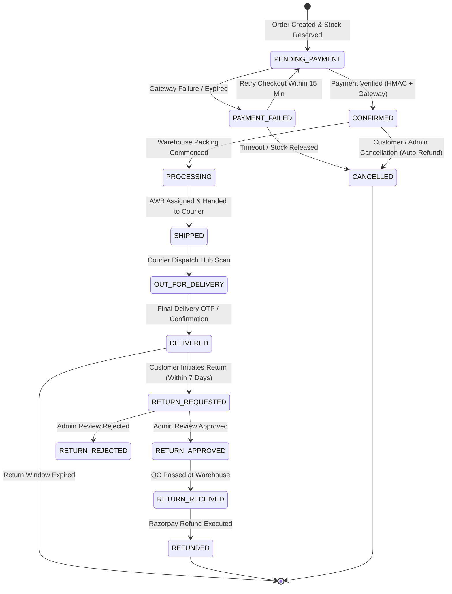

# 07. Complete Business Workflows & State Machines

## 1. Architectural Concurrency & Integrity Principles
Handling multi-user eCommerce workflows requires preventing double-spending and stock overselling. The platform operates on three non-negotiable rules:
1. **Never Trust Client Calculation**: Prices, taxes, discounts, and inventory amounts are recalculated strictly server-side.
2. **Two-Phase Inventory Lock**:
   - **Phase 1 (Stock Reservation)**: When a customer enters checkout, stock is locked for 15 minutes (`reserved_quantity` in `inventory`).
   - **Phase 2 (Hard Deduction)**: Upon verified payment capture (via webhook/callback), `stock_quantity` is permanently decremented and `reserved_quantity` is cleared.
   - **Phase 3 (Auto-Release)**: If a checkout session expires or payment fails permanently, the reserved stock is restored to `available_to_sell`.
3. **Database Concurrency Control**: Uses pessimistic row locking (`SELECT ... FOR UPDATE`) or Redis distributed locks on the variant inventory row during checkout initiation to eliminate race conditions during high-volume sales.

---

## 2. Order Lifecycle State Machine



---

## 3. Detailed Step-by-Step Business Workflows

### Workflow 1: Customer Registration & Login
- **User Action**: Customer inputs email/mobile and password on storefront registration or login modal.
- **Frontend Behavior**: Validates password complexity client-side; sends JSON payload; displays loading indicator.
- **Backend Processing**: 
  - Sanitizes input, checks if email/mobile exists in `users`.
  - For registration: Generates cryptographically secure password hash using `Argon2id`; creates user record; generates email verification token.
  - For login: Verifies credentials, generates secure session / JWT token with CSRF token; regenerates session ID to prevent session fixation.
- **Database Changes**: `users` record inserted or `last_login_at` updated; session stored.
- **Validation**: Email RFC compliance, password min 8 characters with numbers and symbols.
- **Error Handling**: Rate limiting (max 5 failed attempts per 15 min per IP), generic error messages ("Invalid credentials").
- **Notifications**: Welcome email sent asynchronously via queue with verification link.

---

### Workflow 2: Product Browsing & Searching
- **User Action**: Customer types query in search bar or navigates via category dropdown.
- **Frontend Behavior**: Auto-suggest dropdown appears after 3 keystrokes; PLP updates products asynchronously or with fast server-side render.
- **Backend Processing**: Executes parameterized SQL query against `products`, joining `categories` and `product_variants`. Applies index-optimized filters (`price`, `size_id`, `color_id`).
- **Database Changes**: No write mutations. Optional asynchronous increment of `search_logs` or `product_views_count`.
- **Validation**: Query string sanitized against XSS; filter parameters validated against whitelist arrays.
- **Error Handling**: Returns empty state with recommended alternative collections if zero results found.
- **Notifications**: None.

---

### Workflow 3: Product Variant Selection (Size & Color)
- **User Action**: Customer clicks a color swatch, then selects an available size button.
- **Frontend Behavior**: Image gallery switches to selected color's images; size buttons show real-time availability; price updates if variant has differential pricing.
- **Backend Processing**: AJAX call / embedded JSON lookup matches `(product_id, color_id, size_id)` to resolve target `variant_id` and query `inventory` (`stock_quantity - reserved_quantity`).
- **Database Changes**: None.
- **Validation**: Ensure selected size and color combination is an active valid SKU.
- **Error Handling**: If unavailable, disable "Add to Cart" button, show "Out of Stock", and present "Notify Me When Available" button.
- **Notifications**: None.

---

### Workflow 4: Add to Cart
- **User Action**: Customer clicks "Add to Cart" with selected variant and quantity.
- **Frontend Behavior**: Button displays loading spinner; opens slide-over mini cart drawer displaying added item, subtotal, and free shipping progress bar.
- **Backend Processing**:
  - Resolves session cart (for guests) or database cart (`carts` for authenticated users).
  - Queries active variant inventory to ensure `requested_qty <= (stock_quantity - reserved_quantity)`.
  - Upserts item into `cart_items`.
- **Database Changes**: Insert/update in `carts` and `cart_items`.
- **Validation**: Quantity must be positive integer; max limit of 5 per SKU per cart.
- **Error Handling**: Returns `422 Unprocessable Entity` if requested quantity exceeds available stock.
- **Notifications**: None.

---

### Workflow 5: Coupon Application
- **User Action**: Customer enters coupon code (e.g., `SUMMER20`) on cart or checkout page and clicks "Apply".
- **Frontend Behavior**: Displays validation badge; renders itemized discount line and recalculated total.
- **Backend Processing**:
  - Queries `coupons` table for code matching, `is_active = 1`, and valid date window.
  - Checks usage limits: `total_used < max_uses` and `user_used_count < max_uses_per_user`.
  - Checks minimum order value threshold against cart subtotal.
  - Computes discount amount (percentage capped at `max_discount_amount` or flat fixed amount).
- **Database Changes**: Stores `coupon_id` and computed discount in cart session/table.
- **Validation**: Strict validation of coupon rules; rejects expired or exhausted codes.
- **Error Handling**: Returns descriptive user error: *"Coupon expired"*, *"Minimum cart value of ₹1,499 required"*, or *"Valid for first order only"*.
- **Notifications**: None.

---

### Workflow 6: Checkout Initiation & Address Selection
- **User Action**: Customer proceeds to checkout, selects or adds delivery address, and reviews final summary.
- **Frontend Behavior**: Validates address fields; displays shipping rate and tax breakdown; enables "Proceed to Payment".
- **Backend Processing**:
  - Validates delivery pin code against serviceable pin codes table.
  - Calculates final payable: `Subtotal - Coupon Discount + Shipping Fee + Taxes`.
  - Initiates 15-minute stock reservation session.
- **Database Changes**: Upserts `user_addresses`; creates draft `orders` record with status `PENDING_PAYMENT`.
- **Validation**: Phone number format, valid pin code, required street fields.
- **Error Handling**: Blocks progression if any cart item went out of stock during browsing.
- **Notifications**: None.

---

### Workflow 7: Online Payment (Razorpay Integration)
- **User Action**: Customer clicks "Pay Now via Razorpay".
- **Frontend Behavior**: Invokes Razorpay Checkout JavaScript SDK popup modal with `order_id`, key, amount in paise, customer contact prefilled.
- **Backend Processing**:
  - Server calls Razorpay Orders API (`POST /v1/orders`) with total payable amount and unique receipt reference.
  - Receives `razorpay_order_id` and stores in `payments` table.
  - Transmits `razorpay_order_id` to client.
- **Database Changes**: Inserts record into `payments` table with `status = 'CREATED'`.
- **Validation**: Server verifies amount matches exact recalculated cart total (in paise: ₹100.00 = 10000).
- **Error Handling**: Catches Razorpay gateway connectivity timeouts and prompts customer to re-attempt.
- **Notifications**: None.

---

### Workflow 8: Payment Failure & Retry
- **User Action**: Customer's card is declined or customer closes modal without finishing.
- **Frontend Behavior**: Modal closes; checkout displays alert: *"Payment unsuccessful. No money was deducted. Please try another payment method."* Provides "Retry Payment" button.
- **Backend Processing**:
  - Client sends failure callback to server; Razorpay fires `payment.failed` webhook.
  - Server updates `payments` record with failure error code and description.
  - Stock reservation timer remains active for remainder of 15 minutes to allow retry without losing cart items.
- **Database Changes**: Updates `payments` record to `FAILED`.
- **Validation**: Verify payment failure authenticity.
- **Error Handling**: Graceful fallback offering alternate options (UPI, Net Banking, another card).
- **Notifications**: Optional SMS/Email nudge: *"Your order is waiting – complete payment within 10 minutes to secure your items."*

---

### Workflow 9: Successful Order Creation & Dual Verification
- **User Action**: Customer completes payment successfully on Razorpay modal.
- **Frontend Behavior**: Modal submits `razorpay_payment_id`, `razorpay_order_id`, and `razorpay_signature` to backend verification endpoint; redirects to Order Success screen upon confirmation.
- **Backend Processing**:
  - **CRITICAL SECURITY STEP**: Server recalculates HMAC-SHA256 signature:
    `hash_hmac('sha256', $razorpay_order_id . "|" . $razorpay_payment_id, $key_secret)`.
  - Verifies signature strictly matches `razorpay_signature`.
  - Calls Razorpay API to verify payment status is `captured`.
  - Transitions order status to `CONFIRMED`.
  - Finalizes hard inventory deduction.
  - Clears user shopping cart.
- **Database Changes**: 
  - `orders` status updated to `CONFIRMED`.
  - `payments` status updated to `CAPTURED` with gateway transaction reference.
  - `inventory` updated (hard deduction).
  - `coupon_usages` recorded if coupon used.
- **Validation**: Signature verification and amount cross-check.
- **Error Handling**: If signature fails, flag transaction as `SECURITY_ALERT`, do not confirm order, trigger alert.
- **Notifications**: Automated Order Confirmation Email and SMS sent with Order ID, summary, and estimated delivery.

---

### Workflow 10: Inventory Deduction & Concurrency Lock
- **User Action**: Triggered automatically during Checkout (Lock) and Order Confirmation (Deduct).
- **System Behavior**:
  ```sql
  -- Pessimistic locking inside database transaction
  START TRANSACTION;
  SELECT stock_quantity, reserved_quantity 
  FROM inventory 
  WHERE variant_id = :variant_id FOR UPDATE;
  
  -- Validation check
  IF (stock_quantity - reserved_quantity) >= :ordered_qty THEN
      UPDATE inventory 
      SET stock_quantity = stock_quantity - :ordered_qty,
          reserved_quantity = reserved_quantity - :reserved_qty,
          updated_at = NOW()
      WHERE variant_id = :variant_id;
      
      INSERT INTO inventory_movements (variant_id, change_type, quantity, reference_id, created_at)
      VALUES (:variant_id, 'ORDER_DEDUCTION', -:ordered_qty, :order_id, NOW());
      
      COMMIT;
  ELSE
      ROLLBACK;
      -- Return Out of Stock Error
  END IF;
  ```
- **Error Handling**: Prevents any overselling even when hundreds of customers check out the same variant simultaneously.

---

### Workflow 11: Order Processing & Warehouse Packing
- **User Action**: Warehouse operator opens Admin Order Fulfillment dashboard, filters `CONFIRMED` orders, and clicks "Process Packing".
- **Frontend Behavior**: Updates order status badge to `PROCESSING`; prints printable PDF Packing Slip and item checklist.
- **Backend Processing**: Updates `orders.status = 'PROCESSING'`; logs admin user action in `audit_logs`.
- **Database Changes**: `orders` status updated; audit record created.
- **Validation**: Operator can only process orders in `CONFIRMED` state.
- **Notifications**: Internal notification updating fulfillment queue.

---

### Workflow 12: Shipping, AWB Assignment & Dispatch
- **User Action**: Order fulfillment manager inputs courier name (e.g. Blue Dart, Delhivery) and AWB / Tracking number, then clicks "Mark Shipped".
- **Frontend Behavior**: Generates shipping label with barcode; marks order row as `SHIPPED`.
- **Backend Processing**: Creates record in `shipments`; updates `orders.status = 'SHIPPED'`; calculates tracking URL.
- **Database Changes**: Insert into `shipments`; update `orders`.
- **Notifications**: Dispatch SMS & Email dispatched to customer containing courier name, tracking number, and live tracking hyperlink.

---

### Workflow 13: Order Cancellation (Pre-Shipment)
- **User Action**: Customer clicks "Cancel Order" on account order page (available only before order is `SHIPPED`).
- **Frontend Behavior**: Prompts for cancellation reason modal; confirms cancellation; displays refund notice.
- **Backend Processing**:
  - Verifies order status is `CONFIRMED` or `PROCESSING`.
  - Reverses inventory deduction: adds back quantities to `inventory` and logs `CANCELLATION_RESTOCK` in `inventory_movements`.
  - Executes Razorpay Refund API call (`POST /v1/payments/{payment_id}/refund`).
  - Updates order status to `CANCELLED`.
- **Database Changes**: `orders.status = 'CANCELLED'`; `inventory` restored; `refunds` record inserted.
- **Notifications**: Cancellation confirmation and refund initiation email sent to customer.

---

### Workflow 14: Customer Return & Replacement Initiation
- **User Action**: Customer requests return/exchange within 7 days of delivery, chooses reason (e.g. "Size too small"), selects replacement size or return for refund, and uploads item photos.
- **Frontend Behavior**: Validates image upload; submits return ticket; displays ticket reference number.
- **Backend Processing**:
  - Validates delivery date is <= 7 days ago.
  - Verifies item category is return-eligible (e.g., innerwear/masks marked non-returnable).
  - Inserts record into `returns` table with status `REQUESTED`.
- **Database Changes**: Insert into `returns`.
- **Notifications**: Confirmation email to customer; pending review alert in Admin Dashboard.

---

### Workflow 15: Refund Processing (Post-Inspection)
- **User Action**: Admin receives physical return at warehouse, inspects tags and condition, clicks "Approve & Issue Refund".
- **Frontend Behavior**: Confirmation dialog confirming refund amount; updates return status to `REFUNDED`.
- **Backend Processing**:
  - Triggers server-side call to Razorpay Refund API:
    ```php
    $refund = $razorpay->payment->fetch($paymentId)->refund([
        'amount' => $refundAmountInPaise,
        'notes' => ['return_id' => $returnId, 'reason' => 'Customer return approved']
    ]);
    ```
  - Logs refund transaction reference in `refunds` table.
  - Restocks inventory if item marked undamaged.
- **Database Changes**: `returns.status = 'REFUNDED'`, `refunds.status = 'PROCESSED'`, `inventory` updated.
- **Notifications**: Refund confirmation email to customer stating bank credit timeline (5-7 business days).

---

### Workflow 16: Admin Product & Variant Matrix Creation
- **User Action**: Catalog Manager inputs product title, category, description, fabric details, adds size chips (S, M, L, XL) and color swatches (Navy, White), then clicks "Generate Variants".
- **Frontend Behavior**: Automatically renders a dynamic 2D matrix table allowing individual SKU, barcode, price, and stock assignment per row.
- **Backend Processing**:
  - Inserts parent record into `products`.
  - Generates cross-product rows in `product_variants`.
  - Initializes corresponding rows in `inventory`.
  - Associates uploaded image media with respective color IDs.
- **Database Changes**: Multi-table transaction across `products`, `product_variants`, `product_images`, and `inventory`.
- **Validation**: Unique SKU constraint validation, non-empty title, category existence.
- **Notifications**: Success toast and redirect to catalog grid.

---

### Workflow 17: Inventory Updates & Adjustments
- **User Action**: Inventory Manager navigates to SKU stock screen, enters stock adjustment (+50 or -5 units), selects reason code (`PO_RECEIPT`, `DAMAGE_CORRECTION`), and submits.
- **Backend Processing**:
  - Executes database transaction updating `inventory.stock_quantity`.
  - Writes mandatory row to immutable `inventory_movements` table with current timestamp, user ID, delta, and reference notes.
- **Database Changes**: `inventory` updated; `inventory_movements` record created.
- **Validation**: Prohibit adjusting stock below zero; mandatory reason specification.
- **Notifications**: Low-stock alert dismissed if stock raised above safety threshold.

---

### Workflow 18: Customer Support & Inquiries
- **User Action**: Customer submits query via contact form or order inquiry modal.
- **Frontend Behavior**: Validates email/phone and message body; displays ticket submission confirmation.
- **Backend Processing**: Inserts into customer inquiries queue, linked to `order_id` if submitted from order page.
- **Database Changes**: Insert into support tickets / contact messages table.
- **Notifications**: Customer receives acknowledgment email with ticket ID; admin support team receives dashboard notification.

