# 09. Database Entity-Relationship (ER) Diagram

The following Mermaid diagram visualizes the entity-relationship architecture of the 32 relational tables, mapping multi-variant apparel hierarchy, inventory tracking, order lifecycle, payments, and RBAC security.

```mermaid
erDiagram
    ROLES ||--o{ USERS : "assigned to"
    ROLES ||--|{ ROLE_PERMISSIONS : "contains"
    PERMISSIONS ||--|{ ROLE_PERMISSIONS : "granted via"
    
    USERS ||--o{ USER_ADDRESSES : "owns"
    USERS ||--o{ CARTS : "maintains"
    USERS ||--o{ WISHLISTS : "saves"
    USERS ||--o{ ORDERS : "places"
    USERS ||--o{ REVIEWS : "writes"
    USERS ||--o{ NOTIFICATIONS : "receives"
    USERS ||--o{ AUDIT_LOGS : "triggers"
    USERS ||--o{ INVENTORY_MOVEMENTS : "records"
    USERS ||--o{ COUPON_USAGES : "redeems"

    CATEGORIES ||--o{ CATEGORIES : "parent of"
    CATEGORIES ||--o{ PRODUCTS : "categorizes"
    BRANDS ||--o{ PRODUCTS : "labels"

    PRODUCTS ||--|{ PRODUCT_VARIANTS : "has variants"
    PRODUCTS ||--o{ PRODUCT_IMAGES : "has media"
    PRODUCTS ||--o{ WISHLIST_ITEMS : "saved in"
    PRODUCTS ||--o{ REVIEWS : "reviewed on"

    SIZES ||--o{ PRODUCT_VARIANTS : "defines size"
    COLORS ||--o{ PRODUCT_VARIANTS : "defines color"
    COLORS ||--o{ PRODUCT_IMAGES : "maps image to"

    PRODUCT_VARIANTS ||--|| INVENTORY : "tracked in"
    PRODUCT_VARIANTS ||--o{ INVENTORY_MOVEMENTS : "audited via"
    PRODUCT_VARIANTS ||--o{ CART_ITEMS : "added as"
    PRODUCT_VARIANTS ||--o{ ORDER_ITEMS : "sold as"

    CARTS ||--o{ CART_ITEMS : "holds"
    WISHLISTS ||--o{ WISHLIST_ITEMS : "holds"

    COUPONS ||--o{ COUPON_USAGES : "tracks redemption"

    ORDERS ||--|{ ORDER_ITEMS : "contains"
    ORDERS ||--o{ PAYMENTS : "paid via"
    ORDERS ||--o| SHIPMENTS : "fulfilled by"
    ORDERS ||--o{ RETURNS : "disputes via"
    ORDERS ||--o{ REFUNDS : "reimbursed via"

    RETURNS ||--o{ REFUNDS : "triggers"
    ORDER_ITEMS ||--o{ RETURNS : "item returned"

    PAYMENTS ||--o{ REFUNDS : "debited from"

    ROLES {
        bigint id PK
        string name
        string slug UK
    }

    PERMISSIONS {
        bigint id PK
        string slug UK
        string module
    }

    ROLE_PERMISSIONS {
        bigint role_id PK, FK
        bigint permission_id PK, FK
    }

    USERS {
        bigint id PK
        bigint role_id FK
        string email UK
        string phone UK
        string password_hash
        boolean is_active
    }

    USER_ADDRESSES {
        bigint id PK
        bigint user_id FK
        string address_type
        string city
        string state
        string postal_code
    }

    CATEGORIES {
        bigint id PK
        bigint parent_id FK
        string name
        string slug UK
        int display_order
    }

    BRANDS {
        bigint id PK
        string name UK
        string slug UK
    }

    SIZES {
        bigint id PK
        string name
        string code UK
        string category_group
    }

    COLORS {
        bigint id PK
        string name UK
        string hex_code
    }

    PRODUCTS {
        bigint id PK
        bigint category_id FK
        bigint brand_id FK
        string name
        string slug UK
        decimal base_price
        boolean is_active
    }

    PRODUCT_VARIANTS {
        bigint id PK
        bigint product_id FK
        bigint size_id FK
        bigint color_id FK
        string sku UK
        string barcode UK
        decimal price_override
    }

    PRODUCT_IMAGES {
        bigint id PK
        bigint product_id FK
        bigint color_id FK
        string image_url
        boolean is_primary
    }

    INVENTORY {
        bigint id PK
        bigint variant_id FK, UK
        int stock_quantity
        int reserved_quantity
        int safety_stock_threshold
    }

    INVENTORY_MOVEMENTS {
        bigint id PK
        bigint variant_id FK
        bigint user_id FK
        string change_type
        int quantity
        string reference_id
    }

    CARTS {
        bigint id PK
        bigint user_id FK
        string session_token UK
        bigint coupon_id
    }

    CART_ITEMS {
        bigint id PK
        bigint cart_id FK
        bigint variant_id FK
        int quantity
    }

    WISHLISTS {
        bigint id PK
        bigint user_id FK, UK
    }

    WISHLIST_ITEMS {
        bigint id PK
        bigint wishlist_id FK
        bigint product_id FK
    }

    COUPONS {
        bigint id PK
        string code UK
        string discount_type
        decimal discount_value
        decimal min_order_value
        timestamp end_date
    }

    COUPON_USAGES {
        bigint id PK
        bigint coupon_id FK
        bigint user_id FK
        bigint order_id FK
        decimal discount_amount
    }

    ORDERS {
        bigint id PK
        string order_number UK
        bigint user_id FK
        string customer_name
        decimal total_amount
        string status
        string payment_status
        json shipping_address
    }

    ORDER_ITEMS {
        bigint id PK
        bigint order_id FK
        bigint variant_id FK
        string sku
        string size_name
        string color_name
        decimal unit_price
        int quantity
    }

    SHIPMENTS {
        bigint id PK
        bigint order_id FK, UK
        string carrier_name
        string tracking_number
        timestamp shipped_at
    }

    PAYMENTS {
        bigint id PK
        bigint order_id FK
        string gateway_order_id UK
        string gateway_payment_id UK
        decimal amount
        string status
    }

    PAYMENT_WEBHOOKS {
        bigint id PK
        string event_id UK
        string event_type
        json payload
        boolean is_processed
    }

    RETURNS {
        bigint id PK
        bigint order_id FK
        bigint order_item_id FK
        string reason
        string status
    }

    REFUNDS {
        bigint id PK
        bigint order_id FK
        bigint payment_id FK
        string gateway_refund_id UK
        decimal amount
        string status
    }

    REVIEWS {
        bigint id PK
        bigint product_id FK
        bigint user_id FK
        int rating
        boolean is_approved
    }

    BANNERS {
        bigint id PK
        string title
        string image_url_desktop
        string target_url
        boolean is_active
    }

    NOTIFICATIONS {
        bigint id PK
        bigint user_id FK
        string title
        string type
        timestamp read_at
    }

    SETTINGS {
        bigint id PK
        string setting_group
        string key_name UK
        string value
    }

    AUDIT_LOGS {
        bigint id PK
        bigint user_id FK
        string action
        string entity_type
        string entity_id
        string ip_address
    }
```

