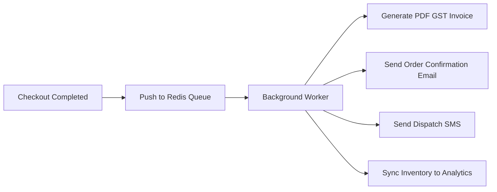
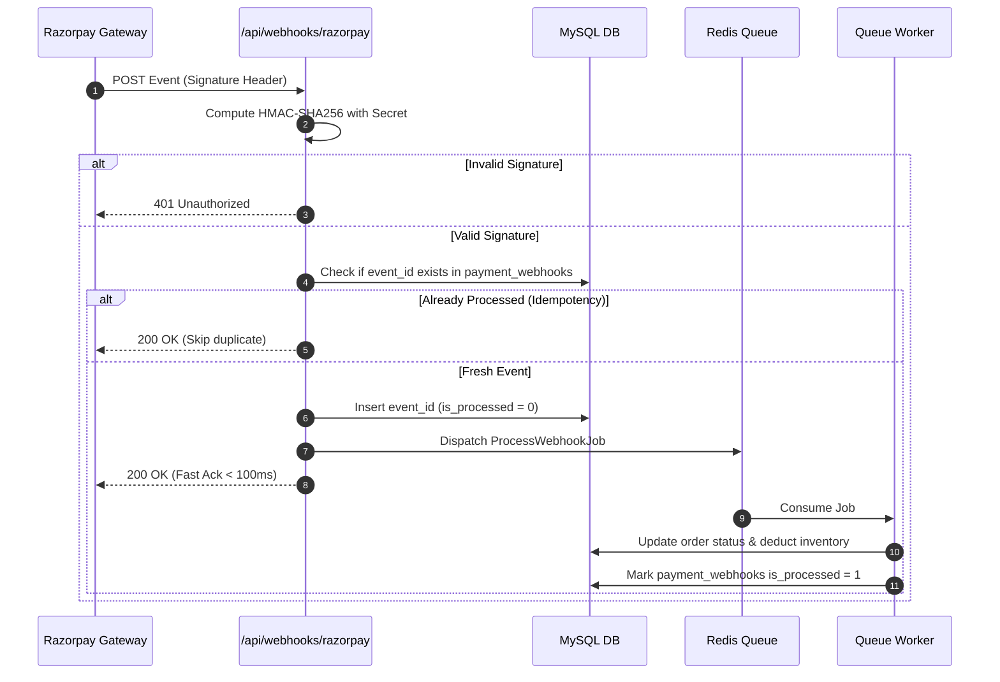

# 10. System Architecture & Topology

## 1. High-Level Architectural Pattern
The platform follows a **Clean Modular Layered Architecture** with distinct presentation boundaries, shared domain service logic, and strict repository-based data access.

```
+-------------------------------------------------------------------------------+
|                           EDGE & SECURITY LAYER                               |
|        Cloudflare CDN (DDoS, WAF, Edge Caching, TLS 1.3 Termination)          |
+-------------------------------------------------------------------------------+
                                        │
                                        ▼
+-------------------------------------------------------------------------------+
|                            WEB SERVER & REVERSE PROXY                         |
|        Nginx (Static Asset Serving, Gzip/Brotli, FastCGI Cache, SSL)          |
+-------------------------------------------------------------------------------+
                                        │
                                        ▼
+-------------------------------------------------------------------------------+
|                         APPLICATION ENGINE (PHP 8.2+)                         |
|  ┌───────────────────────────────┐         ┌───────────────────────────────┐  |
|  │      Storefront Context       │         │      Admin Portal Context     │  |
|  │  (SSR Blade + Alpine.js UI)   │         │  (SSR Blade + Admin Panels)   │  |
|  └──────────────┬────────────────┘         └───────────────┬───────────────┘  |
|                 │                                          │                  |
|                 ▼                                          ▼                  |
|  ┌─────────────────────────────────────────────────────────────────────────┐  |
|  │                           SHARED DOMAIN SERVICES                        │  |
|  │  - CatalogService      - CartService           - OrderFulfillmentService│  |
|  │  - InventoryLockService- PricingCouponEngine   - RazorpayPaymentAdapter │  |
|  │  - AddressService      - ReturnRefundService   - AuditLogger            │  |
|  └────────────────────────────────────┬────────────────────────────────────┘  |
|                                       │                                       |
|                                       ▼                                       |
|  ┌─────────────────────────────────────────────────────────────────────────┐  |
|  │                         DATA ACCESS REPOSITORY LAYER                    │  |
|  │             (Prepared Statements PDO / Active Record ORM)               │  |
|  └─────────────────────────────────────────────────────────────────────────┘  |
+---------------------------------------┬───────────────────────────────────────+
                                        │
        ┌───────────────────────────────┴───────────────────────────────┐
        ▼                                                               ▼
+────────────────---------------+                             +────────────────-+
|      PERSISTENCE STORAGE      |                             |   CACHE & LOCKS |
|  MySQL 8.0+ / MariaDB 10.6+   |                             |   Redis Store   |
|  - ACID Transaction Engine    |                             |   - Sessions    |
|  - Row-Level Locking          |                             |   - Cart Cache  |
|  - Foreign Key Integrity      |                             |   - Stock Locks |
+───────────────────────────────+                             +────────────────-+
```

---

## 2. Asynchronous Queue & Background Worker Architecture
To ensure customer response times remain `< 200ms`, all non-blocking operations are offloaded to an asynchronous background worker pool (managed by Redis + Supervisor):



### Queue Channels
1. **`high-priority`**: Razorpay webhook processing, stock release timers, password reset emails.
2. **`default`**: Order confirmation emails, SMS dispatch notifications, GST invoice PDF generation.
3. **`reports`**: Nightly CSV sales exports, inventory reconciliation checks.

---

## 3. Media & File Storage Architecture
Clothing eCommerce is highly image-intensive.
1. **Upload Pipeline**: Admin uploads high-resolution photography (`PNG`/`JPEG`).
2. **Processing**: Background worker strips EXIF data, generates progressive **WebP** variants in three standard dimensions:
   - Thumbnail: `150x200`
   - Card/Listing: `600x800`
   - High-Res Zoom: `1200x1600`
3. **Storage**: Assets are streamed to S3-compatible cloud storage (Cloudflare R2 / AWS S3 / MinIO).
4. **Delivery**: Served through global CDN edge cache with immutable `Cache-Control: public, max-age=31536000` headers.

---

## 4. Webhook Processing Topology (Razorpay)


