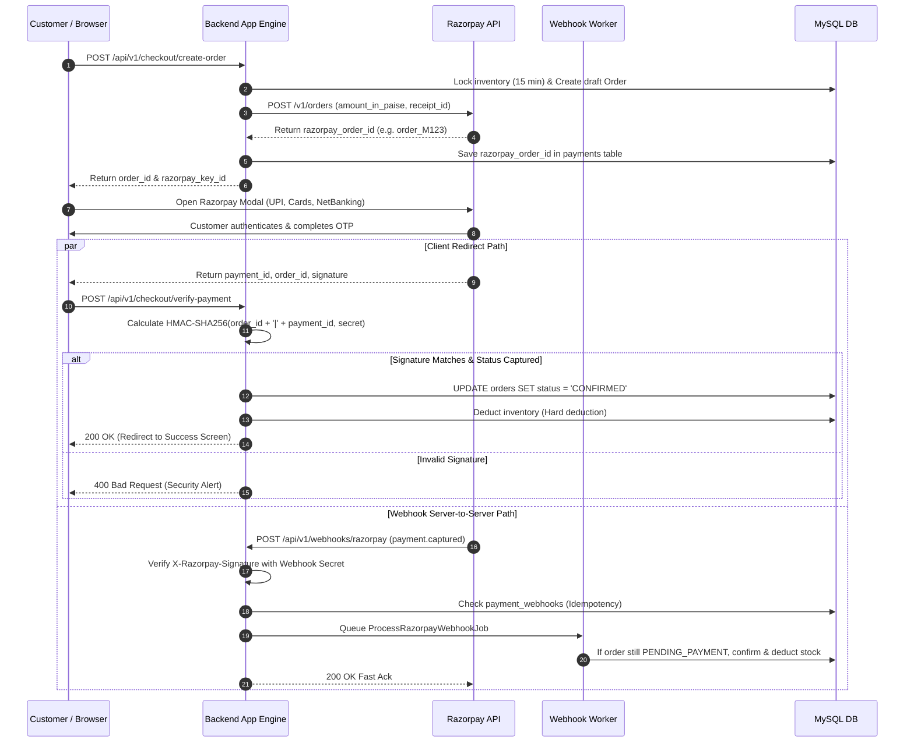
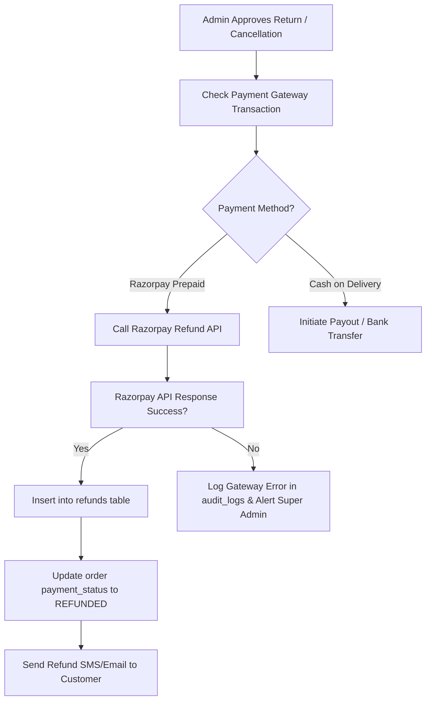

# 14. Payment Gateway Integration Architecture (Razorpay)

## 1. Zero-Trust Security Standard
**Fundamental Mandate**: Under no circumstances shall an order be transitioned to `CONFIRMED` based solely on a client-side callback or frontend JavaScript response. 
All monetary transactions require **dual server-side verification**:
1. Cryptographic validation of the `HMAC-SHA256` signature using the private `RAZORPAY_KEY_SECRET`.
2. Direct server-to-server inquiry to the Razorpay Payments API to verify status is strictly `captured` and `amount` matches the database order amount in paise.

---

## 2. End-to-End Sequence Diagram



---

## 3. Cryptographic Signature Verification Logic

The signature must be calculated and verified using constant-time comparison to prevent timing attacks:

```php
namespace App\Services\Payments;

use Exception;

class RazorpayServiceAdapter 
{
    private string $keyId;
    private string $keySecret;
    private string $webhookSecret;

    public function __construct() 
    {
        $this->keyId = config('razorpay.key_id');
        $this->keySecret = config('razorpay.key_secret');
        $this->webhookSecret = config('razorpay.webhook_secret');
    }

    /**
     * Verifies the client-side Razorpay payment signature.
     */
    public function verifyPaymentSignature(string $orderId, string $paymentId, string $signature): bool 
    {
        $expectedSignature = hash_hmac('sha256', $orderId . '|' . $paymentId, $this->keySecret);
        
        // hash_equals protects against timing attacks
        return hash_equals($expectedSignature, $signature);
    }

    /**
     * Verifies incoming webhook request signatures.
     */
    public function verifyWebhookSignature(string $rawPayload, string $signatureHeader): bool 
    {
        $expectedSignature = hash_hmac('sha256', $rawPayload, $this->webhookSecret);
        return hash_equals($expectedSignature, $signatureHeader);
    }
}
```

---

## 4. Race Condition & Concurrency Resolution: Webhook vs. Frontend Callback

In real-world networks, three scenarios occur:
1. **Frontend callback arrives before Webhook**:
   - The frontend endpoint verifies signature, captures payment, confirms order, and deducts inventory.
   - When the webhook later arrives, the idempotency check detects that the order is already `CONFIRMED`. It records the webhook event as processed and exits cleanly.
2. **Webhook arrives before Frontend callback** (e.g., user browser freezes or closes before redirect):
   - Webhook worker verifies signature, confirms order, and deducts inventory.
   - When the user's browser later re-submits or reconnects, the backend detects the order is already `CONFIRMED` and immediately renders the success screen without duplicate stock deduction.
3. **Simultaneous Processing (Exact Race Condition)**:
   - Handled via database atomic transaction with `SELECT ... FOR UPDATE` on the `orders` row. Whichever process acquires the lock first updates the order from `PENDING_PAYMENT` to `CONFIRMED`. The second process sees `status != 'PENDING_PAYMENT'` and safely bypasses redundant execution.

---

## 5. Webhook Idempotency & Replay Attack Defense
1. The incoming webhook event payload includes `event_id` (e.g., `evt_123456789`).
2. The system checks `payment_webhooks` table:
   ```sql
   INSERT INTO payment_webhooks (gateway, event_id, event_type, payload, is_processed) 
   VALUES ('RAZORPAY', :event_id, :event_type, :payload, 0)
   ON DUPLICATE KEY UPDATE id = id;
   ```
3. If the insert encounters a duplicate key error or zero affected rows, the system recognizes a replay/duplicate delivery and immediately replies with HTTP `200 OK` without re-running any business logic.

---

## 6. Refund Processing Architecture
Refunds can be initiated via Admin for customer returns or pre-shipping cancellations:



### Server-to-Server Refund API Call
```php
$refundPayload = [
    'amount' => (int)($refundAmountInRupees * 100), // Converted to paise
    'reverse_all' => false,
    'notes' => [
        'order_number' => $order->order_number,
        'return_id' => $returnRequest->id,
        'reason' => 'Defective size exchanged or returned'
    ]
];

$razorpayRefund = $razorpayClient->payment
    ->fetch($payment->gateway_payment_id)
    ->refund($refundPayload);

// Store refund transaction record
Refund::create([
    'order_id' => $order->id,
    'payment_id' => $payment->id,
    'gateway_refund_id' => $razorpayRefund->id,
    'amount' => $refundAmountInRupees,
    'status' => 'PROCESSED'
]);
```

---

## 7. Supported Payment Methods Breakdown
Through Razorpay's Standard Checkout, the platform will natively accept:
- **UPI**: Instant intent and QR flow (Google Pay, PhonePe, Paytm, CRED).
- **Cards**: RuPay, Visa, MasterCard, American Express (with mandatory RBI-compliant 2FA / 3D-Secure).
- **Net Banking**: All major Indian banks (SBI, HDFC, ICICI, Axis, Kotak, etc.).
- **Wallets & Pay Later**: Supported digital wallets and approved Buy-Now-Pay-Later (BNPL) credit providers.

